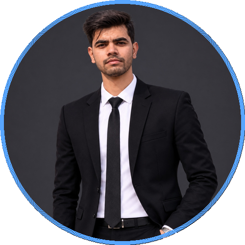

<div align="center">

  <!-- Profile Avatar with Theme-Matched Border Ring -->
  <a href="https://github.com/Shauryaaaa07">
    
  </a>

  <br /><br />

  <!-- Typing SVG Banner with matched Cyan/Blue Gradient colors -->
  <a href="https://github.com/Shauryaaaa07">
    
  </a>

  <p align="center">
    <strong>B.Tech in Computer Science & Engineering</strong> &bull; 
    <strong>Aspiring Software Engineer</strong> &bull; 
    <strong>AI / ML Explorer</strong>
  </p>

  <!-- Status & Profile Badges (Matched Slate & Ocean Palette) -->
  <p align="center">
    <a href="https://github.com/Shauryaaaa07">
      
    </a>
    
    
  </p>

  <p align="center">
    <a href="#-about-me">About Me</a> &bull;
    <a href="#-tech-stack">Tech Stack</a> &bull;
    <a href="#-featured-projects">Featured Projects</a> &bull;
    <a href="#-github-metrics">Analytics</a> &bull;
    <a href="#-get-in-touch">Connect</a>
  </p>

</div>

<br />

---

### 🚀 About Me

```yaml
name: Shaurya Pratap Singh
role: Aspiring Software Engineer & AI/ML Developer
education: B.Tech in Computer Science and Engineering
interests:
  - Software Engineering & Clean Architecture
  - Artificial Intelligence & Computer Vision (OpenCV, CNNs)
  - Full-Stack Web Development & APIs
  - Algorithmic Problem Solving
current_focus: Building intelligent vision systems & full-stack applications
hackathons: Smart India Hackathon (SIH) Participant
location: Uttar Pradesh, India
```

- 💡 Passionate about turning complex real-world challenges into clean, maintainable software.
- 🔭 Actively developing **Computer Vision** prototypes (real-time sign language detection) and **ML models**.
- 🤝 Open to internships, software engineering roles, and collaborative open-source contributions.

---

### 🛠️ Tech Stack

#### 💻 Languages
<p align="left">
  
  
  
  
  
  
  
</p>

#### 🧠 AI, Machine Learning & Data
<p align="left">
  
  
  
  
  
</p>

#### 🌐 Frameworks & Backend
<p align="left">
  
  
  
</p>

#### ⚙️ Developer Tools & Environment
<p align="left">
  
  
  
</p>

---

### 🌟 Featured Projects

<table>
  <tr>
    <td width="50%" valign="top">
      <h3 align="center">🤟 Sign Language Alphabet Recognition</h3>
      <p align="center">
        
        
      </p>
      <p>End-to-end AI-powered finger-spelling recognition system featuring a custom 4-layer CNN, real-time webcam inference, and interactive accessibility web dashboard.</p>
      <p align="center">
        <a href="https://github.com/Shauryaaaa07/Sign-Language-Alphabet-Recognition"><b>View Repository &rarr;</b></a>
      </p>
    </td>
    <td width="50%" valign="top">
      <h3 align="center">🛰️ GeoNexus (SIH 26227)</h3>
      <p align="center">
        
        
      </p>
      <p>Smart India Hackathon project leveraging data engineering and predictive machine learning models to analyze geospatial patterns and deliver actionable insights.</p>
      <p align="center">
        <a href="https://github.com/Shauryaaaa07/GeoNexus-SIH26227"><b>View Repository &rarr;</b></a>
      </p>
    </td>
  </tr>
  <tr>
    <td width="50%" valign="top">
      <h3 align="center">🧠 Accident Prediction Model</h3>
      <p align="center">
        
        
      </p>
      <p>Binary classification machine learning pipeline analyzing demographic and behavioral variables to accurately predict survival probability and severity.</p>
      <p align="center">
        <a href="https://github.com/Shauryaaaa07/Accident_predection_model"><b>View Repository &rarr;</b></a>
      </p>
    </td>
    <td width="50%" valign="top">
      <h3 align="center">📝 Interactive Online Quiz System</h3>
      <p align="center">
        
        
      </p>
      <p>Modern web-based evaluation platform with timed test sessions, dynamic category selection, automated score tallying, and instant performance feedback.</p>
      <p align="center">
        <a href="https://github.com/Shauryaaaa07/Online_quiz_system"><b>View Repository &rarr;</b></a>
      </p>
    </td>
  </tr>
</table>

---

### 📊 GitHub Metrics

<div align="center">
  
  
</div>

<div align="center">
  <br />
  
</div>

---

### 🤝 Get in Touch

<p align="center">
  <a href="https://linkedin.com/in/Shauryaaaa07" target="_blank">
    
  </a>
  &nbsp;
  <a href="mailto:shaurya@example.com" target="_blank">
    
  </a>
  &nbsp;
  <a href="https://github.com/Shauryaaaa07" target="_blank">
    
  </a>
</p>

<p align="center">
  <i>"Code is like humor. When you have to explain it, it’s bad."</i>
</p>
