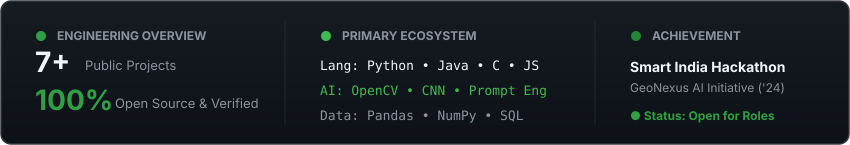
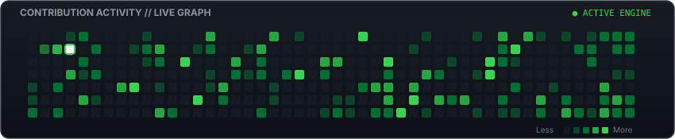

  <!-- Profile Avatar with GitHub Green Border -->
  

    

  <!-- Clean Animated Green Header -->
  

    

  <!-- Official GitHub Green Status Badges -->
  

    
    
    
    
  

---

### 🌿 About Me

I am a **Software Engineer** and **Data Analyst** currently pursuing my **B.Tech in Computer Science and Engineering**. 

- 💻 **Engineering Core:** Passionate about clean code, Object-Oriented Design, and efficient algorithms in **Python**, **Java**, and **C**.
- 🧠 **AI & Computer Vision:** Experienced in building intelligent vision systems using **OpenCV** and custom **CNN architectures** for real-time detection.
- 🤖 **AI Prompt Developer:** Skilled in prompt engineering, context structuring, and leveraging modern LLMs for practical developer workflows.
- 📊 **Data Analytics:** Proficient in exploratory data analysis, pattern recognition, and predictive modeling with **Pandas**, **NumPy**, **Scikit-Learn**, and **SQL**.
- 🛰️ **Geospatial & Predictive Systems:** Developed **GeoNexus**, an automated spatial analytics engine combining machine learning with data visualization.

---

### 🛠️ Technical Skills

<table>
  <tr>
    <td width="25%"><b>Programming Languages</b></td>
    <td>
      
      
      
      
      
      
      
    </td>
  </tr>
  <tr>
    <td><b>AI & Computer Vision</b></td>
    <td>
      
      
      
    </td>
  </tr>
  <tr>
    <td><b>Data Analytics & ML</b></td>
    <td>
      
      
      
      
    </td>
  </tr>
  <tr>
    <td><b>Frameworks & Tools</b></td>
    <td>
      
      
      
      
    </td>
  </tr>
</table>

---

### 🚀 Featured Projects

<table>
  <tr>
    <td width="50%" valign="top">
      <h3>🤟 <a href="https://github.com/Shauryaaaa07/Sign-Language-Alphabet-Recognition">Sign Language Recognition</a></h3>
      
Real-time AI sign language finger-spelling recognition system powered by a custom 4-layer CNN, OpenCV live webcam inference pipeline, and interactive Flask accessibility interface.

      
<b>Stack:</b> <code>Python</code> &bull; <code>OpenCV</code> &bull; <code>CNN</code> &bull; <code>Flask</code>

    </td>
    <td width="50%" valign="top">
      <h3>🛰️ <a href="https://github.com/Shauryaaaa07/GeoNexus-SIH26227">GeoNexus Spatial Analytics</a></h3>
      
Intelligent geospatial processing engine combining predictive data models with automated analytics to translate complex spatial datasets into actionable intelligence.

      
<b>Stack:</b> <code>Python</code> &bull; <code>Data Analytics</code> &bull; <code>Machine Learning</code>

    </td>
  </tr>
  <tr>
    <td width="50%" valign="top">
      <h3>🧠 <a href="https://github.com/Shauryaaaa07/Accident_predection_model">Accident Prediction Model</a></h3>
      
Supervised machine learning binary classification model utilizing Logistic Regression to predict survival probabilities and evaluate safety parameters.

      
<b>Stack:</b> <code>Python</code> &bull; <code>Scikit-Learn</code> &bull; <code>Pandas</code>

    </td>
    <td width="50%" valign="top">
      <h3>📝 <a href="https://github.com/Shauryaaaa07/Online_quiz_system">Online Quiz Platform</a></h3>
      
Responsive web evaluation engine featuring automated score calculation, countdown timers, dynamic question categories, and real-time result analytics.

      
<b>Stack:</b> <code>JavaScript</code> &bull; <code>HTML5</code> &bull; <code>CSS3</code>

    </td>
  </tr>
</table>

---

### 📊 Engineering Metrics

  

 

---

### 🐍 Contribution Activity Graph

  

---

### 📬 Connect With Me

  
  &nbsp;&nbsp;
  
  &nbsp;&nbsp;
  

